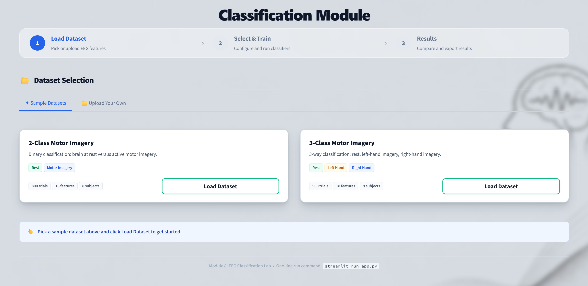
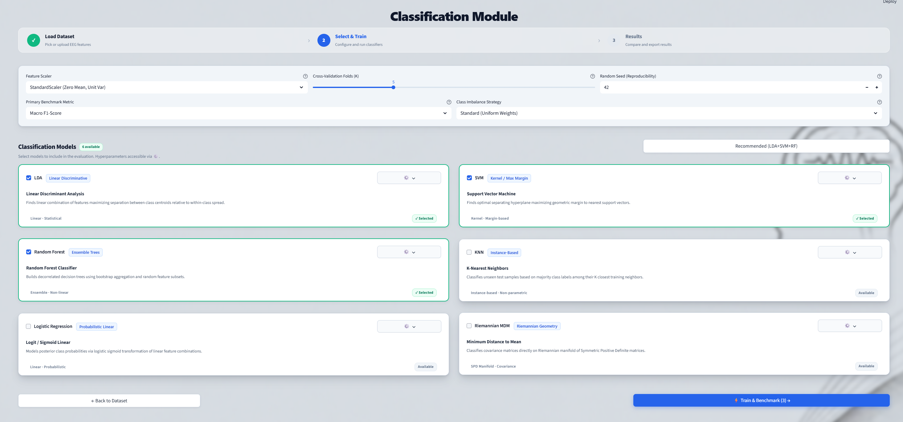
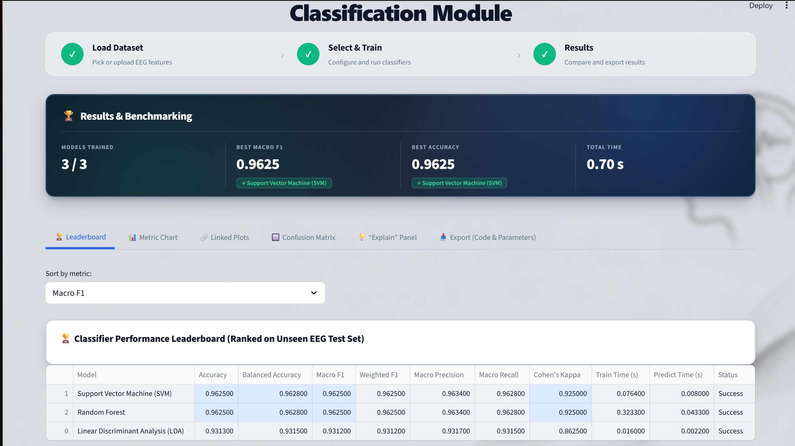

# 🧠 EEG Classification Lab — BCI Course Project (Module 8)

An interactive, scientific machine learning laboratory and educational tool designed for **Brain-Computer Interface (BCI)** feature classification and diagnostic analysis.

---

## ⚡ Quick Start: One-Line Run Command

### 1. Install Dependencies
```bash
pip install -r requirements.txt
```

### 2. Launch the Application
```bash
streamlit run app.py
```
> The application will open automatically in your browser at `http://localhost:8501`.

### 3. Run Automated Tests
```bash
python -m pytest tests -v
```
*(All 21 unit tests verify pipeline execution, leakage prevention, metrics accuracy, and artifact exports).*

---

## 🧭 The 3-Step Workflow

The lab guides researchers and students through a clear 3-step experiment lifecycle:

```
[ 1. Load Dataset ]  ──>  [ 2. Select & Train ]  ──>  [ 3. Results & Benchmarking ]
```

### Step 1: Load Dataset
Choose from built-in standard BCI paradigms (Motor Imagery, P300 Speller, Alpha Neurofeedback) or upload custom single or separate CSV feature files with participant-aware group splitting.


*Figure 1: Step 1 — Load Dataset interface & paradigm selector.*

---

### Step 2: Select & Train Classifiers
Configure global preprocessing pipelines (StandardScaler, CV Folds, Seeds) and toggle scikit-learn classifiers (LDA, SVM, Random Forest, KNN, Logistic Regression) with per-model hyperparameter tuning popovers.


*Figure 2: Step 2 — Classifier configuration & training workbench.*

---

### Step 3: Results & Benchmarking
Inspect comprehensive leaderboard rankings, live-updating linked diagnostic plots, dedicated confusion matrices, conceptual Q&A explanations, and export standalone Python scripts, trained `.joblib` models, CSV tables, and JSON manifests.


*Figure 3: Step 3 — Results, benchmarking leaderboard & artifact manager.*

---

## 📋 Course Rubric Compliance Matrix

This project fulfills all required course deliverables:

| Requirement | Implementation Details | Status |
|---|---|:---:|
| **1. Sample Data + File Upload** | 3 preloaded EEG paradigms + Single CSV & Separate CSVs file upload with column selectors and group splitting. | ✅ Verified |
| **2. 5+ Adjustable Parameters** | Global: Scaler (`StandardScaler`, `Robust`, `MinMax`), CV Folds (3–10), Random Seed, Target Metric, Class Weighting. Model-level: 15+ hyperparameters across LDA, SVM, RF, KNN, LR. | ✅ Verified |
| **3. 2 Linked Live-Updating Plots** | Linked Plot 1 (Confusion Matrix) and Linked Plot 2 (Per-Class Precision/Recall/F1 or RF Tree Feature Importances) synchronize in lockstep with the active model selector. | ✅ Verified |
| **4. “Explain” Panel with Questions** | Rigorous educational Q&A addressing the 8 core BCI concepts (Accuracy pitfalls, Non-linear boundaries, Confusion Matrix interpretation, Macro F1, Feature scaling, RF bagging, Cohen's Kappa, and Identity leakage). | ✅ Verified |
| **5. Code & Parameter Export** | One-click export of standalone Python training script (`.py`), serialized scikit-learn pipeline (`.joblib`), benchmark summary table (`.csv`), and parameter manifest (`.json`). | ✅ Verified |
| **6. Automated Tests** | 21 comprehensive automated tests across data validation, pipeline assembly, training, metrics, and serialization. | ✅ Verified |
| **7. Contribution Statement** | Equal 25% contribution split among team members A, B, C, and D with defined 10-minute presentation speaking slots. | ✅ [View Statement](CONTRIBUTION_STATEMENT.md) |

---

## 🛠️ Developer Guide & Module Integration

### Project Directory Layout
```text
BCI_course_project/
├── app.py                     # Entrypoint & public API integration wrapper
├── requirements.txt           # Minimal pinned dependencies
├── README.md                  # Quick start, architecture & developer guide
├── USER_GUIDE.md              # Detailed step-by-step user walkthrough
├── CONTRIBUTION_STATEMENT.md  # 1-page equal contribution statement (A, B, C, D)
│
├── classification/            # Core ML Engine (Pure Python / scikit-learn)
│   ├── __init__.py            # Module exports
│   ├── schemas.py             # Dataclass schemas (DatasetBundle, ExperimentResult)
│   ├── sample_data.py         # Synthetic EEG data generator & BCI presets
│   ├── validation.py          # Array validation & sanity checks
│   ├── preprocessing.py       # Pipeline factories (StandardScaler, Imputer)
│   ├── model_registry.py      # Classifier registry & parameter builders
│   ├── training.py            # Central train_and_evaluate() orchestrator
│   ├── evaluation.py          # Metric computation & confusion matrix calculation
│   └── export.py              # Export serializers (.py, .joblib, .csv, .json)
│
├── ui/                        # Presentation Layer (Streamlit & Plotly)
│   ├── styles.py              # Custom CSS styling (Research lab dark/light theme)
│   ├── components.py          # Plots, charts, KPI banners, and metric summary
│   ├── layout.py              # Navigation shell & router
│   ├── data_page.py           # Step 1 view (Data upload & inspection)
│   ├── model_page.py          # Step 2 view (Classifier configuration & training)
│   └── results_page.py        # Step 3 view (Leaderboards, linked plots & artifact manager)
│
├── tests/                     # 21 Automated Pytest Unit Tests
│   ├── test_data_validation.py
│   ├── test_model_registry.py
│   ├── test_training.py
│   ├── test_evaluation.py
│   └── test_exports.py
│
└── docs/                      # Documentation Assets
    └── images/                # Screenshots and UI figures
```

### Upstream Integration Interface
Upstream modules (e.g. **Module 7: Feature Extraction**) can embed the classification pipeline directly into a parent Streamlit application via `render_classification_module()`:

```python
from app import render_classification_module

# In your parent Streamlit application:
render_classification_module(dataset={
    'X_train': X_train,                 # pandas DataFrame or numpy array (trials x features)
    'y_train': y_train,                 # pandas Series or numpy array of class labels
    'X_test': X_test,                   # pandas DataFrame or numpy array
    'y_test': y_test,                   # pandas Series or numpy array
    'feature_names': ['Mu_C3', 'Beta_C4', ...],  # Optional list of feature names
    'class_names': ['Left Hand', 'Right Hand'],  # Optional list of class names
    'dataset_name': 'CSP Bandpower Features'     # Optional dataset title
})
```

---

## 📚 Further Documentation

- **[User Guide (`USER_GUIDE.md`)](USER_GUIDE.md)**: Detailed step-by-step walkthrough of every screen, control, and plot with image placeholders.
- **[Contribution Statement (`CONTRIBUTION_STATEMENT.md`)](CONTRIBUTION_STATEMENT.md)**: 1-page document detailing equal 25% workload split across Team Members A, B, C, and D with presentation speaker allocation.
