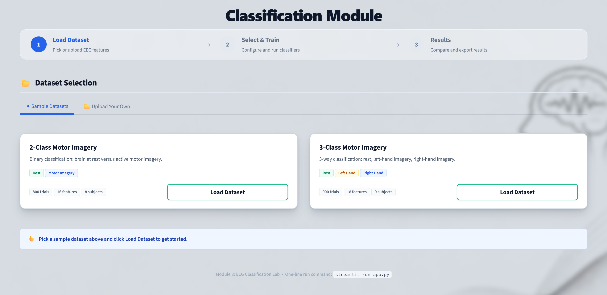
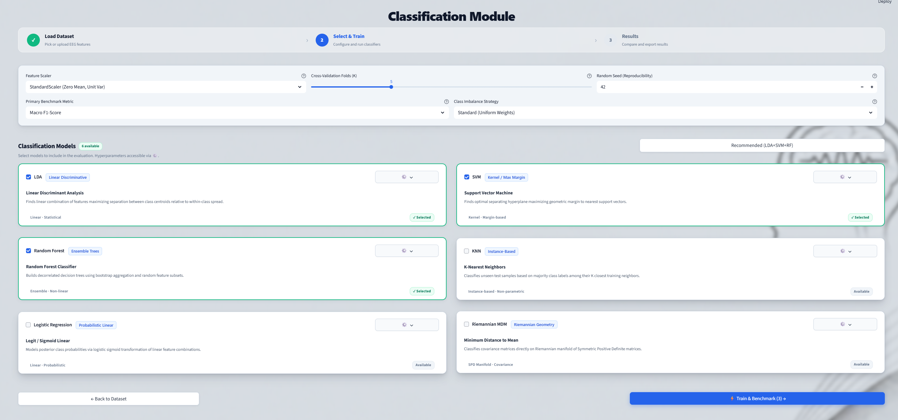
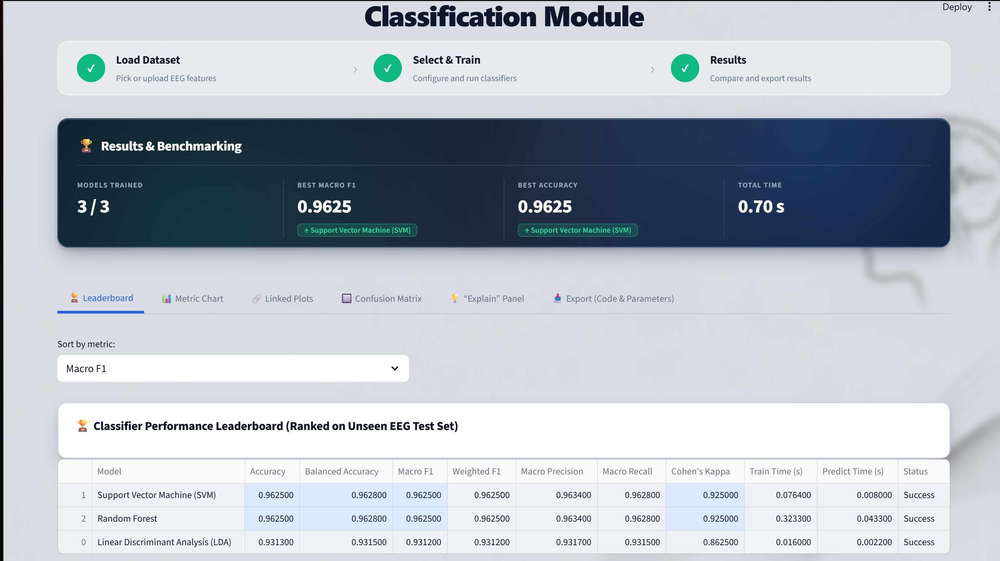

# 📖 User Guide: EEG Classification Lab

A step-by-step walkthrough for students, researchers, and instructors using the **EEG Classification Lab (Module 8)** for Brain-Computer Interface (BCI) machine learning workflows.

---

## 📑 Table of Contents
1. [Introduction & Workflow Overview](#1-introduction--workflow-overview)
2. [Step 1: Dataset Ingestion & Validation](#2-step-1-dataset-ingestion--validation)
3. [Step 2: Classifier Configuration & Training Workbench](#3-step-2-classifier-configuration--training-workbench)
4. [Step 3: Results, Benchmarks & Live Diagnostics](#4-step-3-results-benchmarks--live-diagnostics)
5. [Exporting Artifacts & Reproducibility](#5-exporting-artifacts--reproducibility)
6. [Interactive Educational Explain Panel](#6-interactive-educational-explain-panel)
7. [Common Troubleshooting & FAQs](#7-common-troubleshooting--faqs)

---

## 1. Introduction & Workflow Overview

The EEG Classification Lab provides an end-to-end sandbox to evaluate classical machine learning algorithms on preprocessed electroencephalography (EEG) features (such as bandpower, CSP, ERP amplitudes, and Hjorth parameters).

```
   ┌──────────────────┐       ┌────────────────────┐       ┌────────────────────────┐
   │ 1. Load Dataset  │  ──>  │ 2. Select & Train  │  ──>  │ 3. Results & Benchmark │
   │ (Presets/Upload) │       │ (Pipelines & HPs)  │       │ (Metrics, Plots, Export│
   └──────────────────┘       └────────────────────┘       └────────────────────────┘
```

The top stepper navigation bar indicates your active stage in the classification pipeline.

---

## 2. Step 1: Dataset Ingestion & Validation

In the first step, you load EEG trial features into the laboratory workspace.


*Figure 1.1: Step 1 Data Loading & Ingestion Screen.*

### Option A: Use Built-in BCI Paradigms
1. Under **Data Source**, select **"Preloaded BCI Demo Data"**.
2. Choose one of three standard clinical/research EEG paradigms:
   - **Motor Imagery (2-class)**: Left Hand vs. Right Hand (18 features: mu/beta rhythms at C3, Cz, C4).
   - **P300 Speller (2-class imbalanced)**: Target vs. Non-Target ERP responses (1:5 imbalance).
   - **Alpha Neurofeedback (3-class)**: Relaxed (eyes-closed), Focused (eyes-open), Mental Arithmetic.
3. Observe the summary KPI metrics update immediately:
   - Total Trials / Samples (e.g., 240)
   - Feature Dimensionality (e.g., 18 EEG features)
   - Class Distribution (e.g., 120 / 120 balanced)
   - Missing Values count (0)

> [!TIP]
> Use the **"Feature Matrix Preview"** expander to inspect raw signal statistics and distributions before advancing.

---

### Option B: Upload Custom CSV Data
1. Toggle **Data Source** to **"Upload CSV Files"**.
2. Choose between:
   - **Single CSV**: Contains both features, target label column, and optional participant/subject ID column.
   - **Separate CSVs**: Separate `X_train.csv`, `y_train.csv`, `X_test.csv`, `y_test.csv`.
3. Use the dropdown column selectors to assign:
   - **Target Column**: Select the ground-truth class column.
   - **Subject / Group Column (Optional)**: Select subject IDs to enforce **GroupKFold** splitting (preventing subject identity leakage across cross-validation folds).

```
<!-- USER SCREENSHOT PLACEHOLDER: CUSTOM CSV UPLOAD PREVIEW -->
<!-- To add your own screenshot, save it into docs/images/ and update the path below -->

```

4. Once the green validation alert confirms `✓ Dataset validated successfully`, click the blue button:
   **"Proceed to Select & Train ➔"**

---

## 3. Step 2: Classifier Configuration & Training Workbench

Step 2 is your experiment control room. Here you select candidate classifiers, adjust hyperparameter bounds, and specify global validation rigor.


*Figure 2.1: Step 2 Classifier Configuration & Training Workbench.*

### A. Global Preprocessing & Cross-Validation Setup
Configure global settings that apply consistently across all evaluated models:
1. **Feature Scaler**:
   - `StandardScaler`: Zero-mean, unit-variance normalization (mandatory for LDA and SVM).
   - `RobustScaler`: Uses median and interquartile range (IQR) to resist high-amplitude EEG artifacts and blinks.
   - `MinMaxScaler`: Scales bounded features between $[0, 1]$.
   - `None`: Raw features.
2. **Cross-Validation Folds**: Choose between 3 and 10 folds (default: `5-Fold Stratified CV`).
3. **Random Seed**: Integer seed (default: `42`) guaranteeing bit-for-bit exact reproducibility.
4. **Target Metric**: Choose the optimization metric: `Macro F1`, `Accuracy`, `Balanced Accuracy`, or `Cohen's Kappa`.
5. **Class Weighting**: Toggle `None` or `Balanced` (adjusts loss inversely proportional to class frequencies for imbalanced BCI sets).

```
<!-- USER SCREENSHOT PLACEHOLDER: GLOBAL PREPROCESSING SETTINGS -->

```

---

### B. Selecting and Fine-Tuning Classifiers
Select one or more of the five industry-standard scikit-learn models:

| Classifier | BCI Suitability & Notes | Key Tunable Parameters |
|---|---|---|
| **Linear Discriminant Analysis (LDA)** | Benchmark standard for motor imagery and P300; computationally fast; optimal for Gaussian features. | Solver (`svd`, `lsqr`), Shrinkage regularization (`auto`, `0.1–0.9`). |
| **Support Vector Machine (SVM)** | Powerful for non-linear boundaries in high-dimensional feature spaces. | Kernel (`rbf`, `linear`, `poly`), Cost penalty `C` ($0.1–10.0$), Kernel coefficient `gamma`. |
| **Random Forest (RF)** | Non-linear ensemble; highly robust to noisy channels and outliers; provides Gini feature importance. | Number of estimators ($50–300$), Max tree depth ($3–20$), Min samples split. |
| **k-Nearest Neighbors (KNN)** | Non-parametric instance-based classifier; sensitive to feature scales and Euclidean distances. | Neighbors `k` ($1–15$), Distance metric (`euclidean`, `manhattan`), Weights (`uniform`, `distance`). |
| **Logistic Regression (LR)** | Fast linear baseline with probabilistic calibration. | Penalty (`l2`), Regularization `C` ($0.01–10.0$), Solver (`lbfgs`). |

To adjust model hyperparameters, click the **⚙️ Tuning** popover next to any active classifier.

```
<!-- USER SCREENSHOT PLACEHOLDER: HYPERPARAMETER TUNING POPOVER -->

```

---

### C. Launching Training
Click the prominent action button:
**"🚀 Train Selected Classifiers"**

A live spinner reports real-time fold progression and execution wall-clock time. Upon completion, the application automatically transitions to **Step 3**.

---

## 4. Step 3: Results, Benchmarks & Live Diagnostics

Step 3 displays complete performance benchmarking, interactive diagnostic charts, and scientific telemetry.


*Figure 3.1: Step 3 Results, Leaderboard & Diagnostic Inspection.*

### A. Executive Performance Telemetry
The top telemetry card displays high-level outcomes:
- **Models Trained**: Number of algorithms successfully evaluated (e.g., `3 / 3`).
- **Best Macro F1**: Peak balanced F1 score with the winning model name (e.g., `0.9331` — Support Vector Machine).
- **Best Accuracy**: Peak classification accuracy (e.g., `93.33%`).
- **Total Pipeline Execution Time**: Wall-clock compute duration (e.g., `0.91 s`).

---

### B. Comparative Leaderboard
A structured benchmark table ranks all evaluated classifiers across all standard metrics:
- **Model Name**
- **Accuracy**
- **Balanced Accuracy**
- **Macro Precision**
- **Macro Recall**
- **Macro F1-Score**
- **Cohen's Kappa ($\kappa$)**
- **Fit Time (s)**

Click any column header to sort in ascending or descending order.

```
<!-- USER SCREENSHOT PLACEHOLDER: LEADERBOARD TABLE -->

```

---

### C. Live Linked Diagnostic Plots
Select any evaluated model from the **"Active Model Selector"** dropdown to dynamically update both diagnostic charts in lockstep:

1. **Plot 1: Confusion Matrix**:
   - Heatmap display showing actual vs. predicted trial classes.
   - Toggle between **Raw Counts** and **Normalized Percentages** (row-normalized recall).
   - Diagonal cells indicate true positives; off-diagonals highlight systematic misclassifications (e.g., confusion between C3 and C4 motor imagery).

2. **Plot 2: Model Inspection**:
   - **For Tree Models (Random Forest)**: Displays **Gini Feature Importances** ranking which EEG features (e.g., `C3_Mu_Power`) contributed most to the decisions.
   - **For Linear & Kernel Models (LDA, SVM, KNN, LR)**: Displays **Per-Class Metrics Radar / Bar Breakdown** (Precision, Recall, F1-score per individual class).

```
<!-- USER SCREENSHOT PLACEHOLDER: LINKED DIAGNOSTIC CHARTS -->

```

---

## 5. Exporting Artifacts & Reproducibility

Located at the bottom of Step 3, the **Export Experiment Artifacts** manager provides fully reproducible scientific code and production assets.

The manager is organized into two segmented tabs:

```
┌──────────────────────────────────────┬──────────────────────────────────────┐
│       Executable Assets (2)          │        Experiment Reports (2)        │
└──────────────────────────────────────┴──────────────────────────────────────┘
```

### Tab 1: Executable Assets
1. **Python Training Script (`train_bci_<dataset>.py`)**:
   - Standalone, self-contained Python script replicating the exact scikit-learn pipeline, scaler, hyperparameter dictionary, and stratified split logic.
   - Click **"Preview source code"** to open a dark-mode syntax-highlighted code viewer with internal scrolling and one-click copy.
   - Click **"⬇ Download"** to save to disk.
2. **Serialized Model Pipeline (`<model>_pipeline.joblib`)**:
   - Actual fitted `sklearn.pipeline.Pipeline` binary (including fitted scaler and classifier weights).
   - Select your desired model from the dropdown (e.g., LDA, SVM, RF).
   - Click **"⬇ Download"** to export. Run immediate inference in production Python scripts with `joblib.load()`.

```
<!-- USER SCREENSHOT PLACEHOLDER: EXECUTABLE ASSETS TAB & CODE PREVIEW -->

```

### Tab 2: Experiment Reports
1. **Benchmark Results (`bci_classification_benchmark.csv`)**:
   - Full tabular comparison of all models, metrics, and compute times ready for thesis or paper publication.
2. **Experiment Parameters (`bci_experiment_parameters.json`)**:
   - Machine-readable JSON manifest recording dataset metadata, preprocessing parameters, model hyperparameter dictionaries, and environment timestamps.
   - Expand **"Preview parameters"** for an interactive formatted JSON viewer.

```
<!-- USER SCREENSHOT PLACEHOLDER: EXPERIMENT REPORTS TAB -->

```

---

## 6. Interactive Educational Explain Panel

Directly above the export section, the **💡 “Explain” Panel** provides in-depth conceptual Q&A answering essential BCI machine learning questions:

1. **Why is Accuracy misleading on imbalanced BCI datasets?**
   - Explains how majority-class collapse in P300 spellers (e.g. 85% accuracy predicting all non-targets) yields zero true communication, and why **Macro F1** and **Cohen's Kappa** are vital.
2. **When does LDA outperform non-linear classifiers like SVM or Random Forests?**
   - Details Gaussian feature assumptions, sample-to-feature ratio ($N \ll P$), and avoidance of overfitting on noisy motor imagery trials.
3. **How do I interpret the off-diagonal cells in the Confusion Matrix?**
   - Distinguishes false positives vs false negatives and explains asymmetric clinical costs (e.g. wheelchair movement command vs pause).
4. **What is Cohen's Kappa ($\kappa$) and why is it favored in BCI competitions?**
   - Contrasts observed vs chance agreement ($\kappa = \frac{P_o - P_e}{1 - P_e}$) across balanced and imbalanced trials.
5. **Why is feature scaling essential for SVM and LDA, but optional for Random Forest?**
   - Explains Euclidean distance distortion in RBF kernels and covariance estimation vs monotonic decision-stump thresholding.
6. **How does participant identity leakage happen, and how does GroupKFold prevent it?**
   - Details intra-subject trial correlation, non-stationarity, and cross-subject generalization limits.

```
<!-- USER SCREENSHOT PLACEHOLDER: EXPLAIN PANEL EXPANDED -->

```

---

## 7. Common Troubleshooting & FAQs

### Q: Why do I get low accuracy on my custom uploaded dataset?
- **Check feature distributions**: EEG signals are prone to large baseline drift and ocular artifacts. Toggle the **Feature Scaler** to `RobustScaler` in Step 2.
- **Check class balance**: If classes are uneven, toggle **Class Weighting** to `Balanced`.

### Q: Can I run this offline without internet access?
- **Yes**: All computation, training, plot generation, and file serialization execute 100% locally via pure Python, `scikit-learn`, and `plotly`. No external API calls are made.

### Q: How do I load an exported `.joblib` model in my own script?
```python
import joblib
import numpy as np

# Load the saved pipeline
pipeline = joblib.load("svm_pipeline.joblib")

# Pass new raw EEG features (the pipeline handles scaling automatically)
new_trial = np.random.randn(1, 18)
predicted_class = pipeline.predict(new_trial)
print(f"Decoded BCI Intent: {predicted_class[0]}")
```
